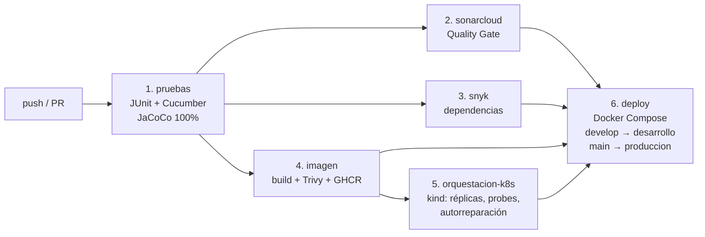

# Catálogo — Microservicio de riesgo catalogo

Microservicio correspondiente al **caso caso09 — SubBox** (E-commerce por suscripción) de la Evaluación Parcial N°1.

| | |
|---|---|
| Stack | Spring Boot 3.5 · Java 21 · Maven · Spring Data JPA · H2 · springdoc-openapi |
| Calidad | JaCoCo cobertura LINE 100% · Cucumber (BDD) alineado a endpoints REST |
| Entrega | Docker · Docker Compose · Kubernetes · GitHub Actions (CI/CD) |

## Responsabilidad (SRP)

administra los datos y la lógica del dominio de Catálogo del caso caso09 (SubBox). Su base de datos es una **H2 en memoria** (un solo microservicio por base), cumpliendo aislamiento de datos por dominio.

## Página de presentación

Al ejecutar el servicio, `http://localhost:8080/` muestra la página de presentación del microservicio con documentación y enlaces a:

- **Swagger UI**: `/swagger-ui/index.html`
- **OpenAPI (yaml)**: `/v3/api-docs.yaml`
- **ReDoc**: `/redoc.html`
- **H2 Console**: `/h2-console`

## Endpoints

| Método | Ruta | Descripción |
|--------|------|-------------|
| GET | `/api/productos` | Lista todos los recursos |
| GET | `/api/productos/{id}` | Obtiene un recurso por id |
| POST | `/api/productos` | Crea un recurso |
| PUT | `/api/productos/{id}` | Actualiza un recurso |
| DELETE | `/api/productos/{id}` | Elimina un recurso |

## Documentación del proyecto

La documentación completa está en la carpeta [`docs/`](docs/):

- [`docs/00_Resumen.md`](docs/00_Resumen.md) — propósito, responsabilidad y tecnologías
- [`docs/01_Arquitectura.md`](docs/01_Arquitectura.md) — componentes, arquitectura y patrones
- [`docs/02_API.md`](docs/02_API.md) — contrato REST y ejemplos curl
- [`docs/03_Pruebas.md`](docs/03_Pruebas.md) — tests unitarios, cobertura y Cucumber
- [`docs/04_Despliegue.md`](docs/04_Despliegue.md)
- [`docs/05_Justificacion.md`](docs/05_Justificacion.md) — justificación del servicio: RF/RNF/seguridad cubiertos, stack y por qué cada tecnología AWS
- [`docs/diagramas/`](docs/diagramas/) — C4 (contexto, contenedores, componentes), secuencia e infraestructura AWS — Docker, Docker Compose e integración

## Cómo ejecutar locmente

```bash
mvn spring-boot:run
```

## Cómo ejecutar con Docker

```bash
docker compose up -d --build     # 2 réplicas + balanceador nginx
# http://localhost:8080
docker compose up -d --scale catalogo-svc=3   # escalar a 3 réplicas
docker compose down
```

## Cómo ejecutar las pruebas

```bash
mvn test      # unit tests + Cucumber
mvn verify    # + verificación de cobertura JaCoCo (100% LINE, falla si baja)
```

## Modelo de ramificación (IE1)

**Modelo elegido: GitFlow** (`main` + `develop` + `feature/<nombre>` + `hotfix/<nombre>`).

Elegimos GitFlow porque el curso se desarrolla durante todo el semestre y cada entrega
(EP01, EP02, EP03) es un hito estable sobre el mismo repositorio. La rama `develop`
permite integrar cambios de funcionalidad sin ensuciar `main`, y la rama `hotfix/`
deja corregir un problema detectado en la versión estable sin interrumpir el trabajo
en curso sobre `develop`. Además, GitFlow separa explícitamente el código estable
(`main`, siempre desplegable) del código en integración (`develop`), lo que da
trazabilidad clara frente a lo que exige la rúbrica de esta evaluación (IE5).

| Modelo | Cómo funciona | Por qué no se eligió |
|--------|---------------|------------------------|
| **GitFlow** ✅ | `main` + `develop` + `feature/` + `hotfix/` | — |
| GitHub Flow | solo `main` + `feature/` + PR | No distingue un estado "en integración" de uno "estable"; más pensado para despliegue continuo sin hitos de evaluación intermedios |
| Trunk-based | rama única de vida corta | Exige integración casi diaria y un pipeline de pruebas maduro; no calza con el ritmo de entregas EP01/EP02/EP03 del curso |

### Estructura de ramas

| Rama | Origen | Propósito | ¿Se borra? |
|------|--------|-----------|------------|
| `main` | inicial | Código estable, siempre listo para producción | No |
| `develop` | `main` | Integración de cambios (features) terminados | No |
| `feature/<nombre>` | `develop` | Un cambio de funcionalidad o documentación | Sí, al fusionarse |
| `hotfix/<nombre>` | `main` | Corrección urgente de un problema en la versión estable | Sí, al fusionarse |

## Convenciones y buenas prácticas (IE5)

### Convención de commits

Formato: `tipo(alcance): descripcion-corta`, en minúsculas y sin tildes.

| Tipo | Para qué | Ejemplo |
|------|----------|---------|
| `feat` | Nueva funcionalidad | `feat(ui): agregar version al pie de pagina` |
| `fix` | Corrección de bug | `fix(docs): corregir typo en README` |
| `docs` | Documentación | `docs: agregar changelog` |
| `chore` | Tareas / CI | `chore(ci): agregar workflow hola mundo` |

### Naming de ramas

`feature/<nombre-corto>` y `hotfix/<nombre-corto>`, en minúsculas y con guiones.
Ejemplos usados en este repositorio: `feature/version-footer`, `feature/changelog`,
`hotfix/typo-readme`.

### Estructura de carpetas

```
catalogo-svc/
├── src/main/java/.../catalogo/        # controller, service, repository, model
├── src/main/resources/static/         # página de presentación (index.html)
├── src/test/java/.../catalogo/        # tests unitarios + steps de Cucumber
├── docs/                              # arquitectura, API, pruebas, despliegue, justificación, diagramas C4
├── .github/workflows/                 # pipeline de GitHub Actions
├── Dockerfile / docker-compose.yml
└── README.md / CHANGELOG.md
```

### Control de versiones

- Un commit = un cambio lógico; nunca mezclar refactor + feature en el mismo commit.
- Cambios en código Java siempre acompañados de su prueba (JaCoCo exige 100% LINE).
- Tags semánticos (`vX.Y.Z`) para marcar parches de hotfix, por ejemplo `v1.0.1`.

### Flujo de merge

- Features y hotfix siempre entran por pull request, nunca push directo a `main` o `develop`.
- Se necesita al menos 1 aprobación antes de fusionar.
- Usar merge commit (se conserva la trazabilidad del PR) y borrar la rama después de fusionar.
- Todo hotfix fusionado en `main` se sincroniza de inmediato a `develop`.

### Estrategia de revisión

- El autor abre el PR con una descripción breve del cambio.
- El revisor comenta, aprueba o pide cambios; nunca se fusiona un PR sin revisión.
- Antes de cada PR: confirmar que `mvn test` pasa y revisar la diff completa.

---

# EP2 — Pipeline CI/CD

> Trabajo **individual**, autorizado por el docente (el encargo original es en parejas).

El pipeline está en [`.github/workflows/ci-cd.yml`](.github/workflows/ci-cd.yml) y corre en
cada push a `main`, `develop`, `feature/**`, `release/**` y `hotfix/**`, y en cada pull request
hacia `main` o `develop`. La evidencia de cada ejecución queda en la pestaña **Actions**.

## Mapa del pipeline



**Regla de bloqueo:** el job `deploy` declara `needs` sobre todos los demás. Si cualquier
prueba, análisis o escaneo falla, el despliegue no se ejecuta. Ningún gate usa
`continue-on-error`.

| Job | Qué hace | Bloquea si… | IE |
|-----|----------|-------------|----|
| `pruebas` | `mvn verify`: pruebas unitarias (JUnit/Mockito), BDD (Cucumber) y `jacoco:check` | una prueba falla o la cobertura de líneas baja del 100% | IE2 |
| `sonarcloud` | Análisis estático en SonarQube Cloud con `sonar.qualitygate.wait=true` | el Quality Gate queda en *Failed* o falta `SONAR_TOKEN` | IE3 |
| `snyk` | `snyk test` sobre `pom.xml` (se activa al crear `SNYK_TOKEN`) | hay vulnerabilidades de severidad alta o crítica | IE3 |
| `imagen` | Build multi-stage, escaneo **Trivy** y publicación en GHCR | Trivy encuentra CVE CRITICAL/HIGH con parche disponible | IE1, IE3 |
| `orquestacion-k8s` | Cluster Kubernetes efímero (kind): aplica `k8s/`, espera el rollout, prueba el servicio y borra un pod para comprobar que se recrea | el rollout no queda listo o hay menos de 2 réplicas sanas | IE5 |
| `deploy` | Despliega la imagen del commit con Docker Compose (2 réplicas + nginx), pruebas de humo, verificación de trazabilidad y prueba de escalado a 3 réplicas | falla el health, el CRUD, la trazabilidad o el escalado | IE4, IE5 |

Además, **Dependabot** ([`.github/dependabot.yml`](.github/dependabot.yml)) revisa cada lunes las
dependencias Maven, la imagen base de Docker y las GitHub Actions, y abre PRs contra `develop`.
Esos PRs pasan por el pipeline completo antes de poder fusionarse.

## IE1 — Contenedores

[`Dockerfile`](Dockerfile) multi-stage:

- **Etapa build:** `maven:3.9-eclipse-temurin-21`. Copia primero `pom.xml` para cachear dependencias.
- **Etapa runtime:** `eclipse-temurin:21-jre-alpine` (solo JRE, sin Maven ni código fuente).
- `apk upgrade` para parches del sistema operativo y `curl` para el `HEALTHCHECK`.
- Usuario **no root** con UID fijo `10001` (Kubernetes lo valida con `runAsNonRoot`).
- `HEALTHCHECK` contra `/actuator/health`.
- JVM limitada al 75% de la memoria del contenedor y `ExitOnOutOfMemoryError`.
- Etiquetas OCI con el commit y la versión (trazabilidad).
- [`.dockerignore`](.dockerignore): solo `pom.xml` y `src/` entran al contexto de build.

## IE2 — Pruebas automatizadas

| Tipo | Archivo | Cubre |
|------|---------|-------|
| Unitarias de servicio | `ProductoServiceTest` | lógica de negocio: crear, buscar, actualizar, eliminar, casos no encontrados |
| Controlador (MockMvc) | `ProductoControllerTest` | rutas REST, códigos 200/201/204/404 y 400 por validación (nombre obligatorio) |
| Configuración | `OpenApiConfigTest` | documentación OpenAPI |
| BDD | `catalogo.feature` + `ProductoSteps` | escenarios de negocio sobre los endpoints reales |

**Política de calidad:** cobertura de líneas **100%** (`jacoco:check` en la fase `verify`).
Los reportes (Surefire y JaCoCo) quedan como artefacto `reportes-pruebas` en cada ejecución.

## IE3 — Seguridad y escalabilidad

**Seguridad (tres capas que bloquean):**

1. **Dependabot:** alertas y PRs semanales por dependencias vulnerables o desactualizadas.
2. **SonarQube Cloud:** bugs, vulnerabilidades, code smells, duplicación y cobertura; el Quality Gate bloquea.
3. **Trivy:** escaneo de la imagen final (sistema operativo y librerías Java); bloquea ante CVE CRITICAL/HIGH con fix.
4. **Snyk (opcional):** se activa solo con crear el secret `SNYK_TOKEN`.

**Escalabilidad:**

| Parámetro | Compose | Kubernetes |
|-----------|---------|------------|
| Réplicas | 2 (escalable con `--scale`) | 2 mínimo, HPA hasta 5 con CPU > 70% |
| CPU | límite 0.5 / reserva 0.25 | request 250m / limit 500m |
| Memoria | límite 512 MB / reserva 256 MB | request 256Mi / limit 512Mi |
| Salud | healthcheck cada 15 s | startup, readiness y liveness probes |
| Despliegue sin caída | balanceador nginx | `RollingUpdate` con `maxUnavailable: 0` |

## IE4 — Despliegue automático y trazabilidad

**Entorno cloud simulado:** el job `deploy` levanta el servicio con Docker Compose dentro del
runner de GitHub (2 réplicas detrás de un balanceador nginx), lo prueba y lo apaga al final.

| Rama | Entorno GitHub | Cuándo |
|------|----------------|--------|
| `develop` | `desarrollo` | cada merge de un feature |
| `main` | `produccion` | cada release o hotfix |

**Cómo se garantiza la trazabilidad (del commit al contenedor):**

1. Todo cambio entra por **pull request** (GitFlow), así que cada commit tiene su PR y su revisión.
2. La imagen se etiqueta con el **SHA del commit** (`sha-<commit>`) y con `versión-del-pom-número-de-ejecución` (ej. `1.0.0-42`).
3. La imagen lleva la etiqueta OCI `org.opencontainers.image.revision=<commit>`.
4. El deploy **no reconstruye**: descarga de GHCR la misma imagen que pasó las pruebas y los escaneos.
5. El deploy verifica que cada contenedor en ejecución tenga el commit esperado, y `/actuator/info` lo informa.
6. El resumen de cada ejecución (pestaña *Actions → Summary*) muestra el commit, la rama, el autor, la imagen y la versión. Los logs quedan como artefacto `deploy-logs-*` por 30 días.

**Cómo se garantiza la calidad:** ningún commit llega a un entorno sin pasar antes las pruebas,
el 100% de cobertura, el Quality Gate de SonarQube y el escaneo de Trivy.

## IE5 — Orquestación

- **Docker Compose** ([`docker-compose.yml`](docker-compose.yml)): 2 réplicas de `catalogo-svc`
  sin puertos propios, más un balanceador **nginx** ([`deploy/nginx/nginx.conf`](deploy/nginx/nginx.conf))
  que reparte la carga y reintenta en otra réplica si una falla. Tiene healthchecks, `restart: unless-stopped`
  y límites de recursos.
- **Kubernetes** ([`k8s/`](k8s/)): `namespace`, `deployment` (2 réplicas, probes, recursos,
  `securityContext` sin root ni privilegios), `service` y `hpa`. El pipeline lo aplica en un
  cluster kind y comprueba la autorreparación borrando un pod.

> Limitación conocida: la base H2 es en memoria, así que cada réplica tiene sus propios datos.
> Para compartir el estado entre réplicas se necesitaría una base externa (por ejemplo PostgreSQL o RDS).

## Configuración necesaria (una sola vez)

1. **SonarQube Cloud:** entrar a <https://sonarcloud.io> con GitHub, importar este repositorio,
   en *Administration → Analysis Method* **desactivar "Automatic Analysis"**, y copiar el token.
2. **Secret `SONAR_TOKEN`:** *Settings → Secrets and variables → Actions → New repository secret*.
3. *(Opcional)* **Secret `SNYK_TOKEN`** desde <https://app.snyk.io> → *Account settings*.
4. **Settings → Actions → General → Workflow permissions:** *Read and write permissions*.
5. **Settings → Code security:** activar *Dependabot alerts* y *Dependabot security updates*.

## Declaración de uso de IA

Se utilizó **Claude Opus 5.5 (Anthropic, https://claude.ai)** como apoyo para:

| Uso | Dónde |
|-----|-------|
| Redacción de archivos de configuración | `Dockerfile`, `.dockerignore`, `.github/workflows/ci-cd.yml`, `.github/dependabot.yml`, `docker-compose.yml`, `deploy/nginx/nginx.conf`, `k8s/` |
| Redacción de la documentación descriptiva | secciones EP2 de este README |
| Redacción asistida de la justificación técnica | sección "Justificación técnica de las decisiones" (marcada abajo) |

Todo el contenido generado fue revisado, probado en el pipeline y validado por la autora.
La reflexión individual fue redactada sin IA. Referencia: Duoc UC, guía de uso de IA,
<https://bibliotecas.duoc.cl/ia>.

## Justificación técnica de las decisiones

> Redactada con apoyo de IA (Claude Opus 5.5, Anthropic) y revisada por la autora.

**Docker Compose para el deploy y Kubernetes para la orquestación.** El enunciado pide un
entorno cloud *simulado*. Compose levanta el servicio completo (réplicas + balanceador) dentro
del runner de GitHub sin costo ni credenciales de nube, y permite probarlo de verdad después de
cada despliegue. Kubernetes se agregó porque es el orquestador que se usa en producción y el que
pide la EP3: probar los manifiestos ya en la EP2 (en un cluster kind efímero) deja validados las
probes, los límites de recursos y la autorreparación antes de llevarlos a la nube.

**SonarQube Cloud + Trivy (+ Dependabot) en vez de una sola herramienta.** Cada una mira una
capa distinta: SonarQube revisa el código fuente (bugs, vulnerabilidades, code smells,
cobertura); Trivy revisa la imagen final, que incluye el sistema operativo Alpine y todas las
librerías Java empaquetadas; Dependabot vigila en el tiempo las dependencias que ya estaban
aprobadas. Con una sola herramienta quedaría una capa sin revisar. Se eligió SonarQube sobre Snyk
como gate principal porque es gratuito para repositorios públicos y porque la EP3 exige su
Quality Gate; Snyk quedó preparado como capa adicional.

**Los gates bloquean (sin `continue-on-error`).** Un análisis que solo avisa no impide que un
cambio inseguro llegue a producción. Por eso el job `deploy` depende de todos los demás: si uno
falla, no hay despliegue.

**Cobertura del 100% como política.** El microservicio es pequeño (un CRUD), por lo que cubrir
todas las líneas es alcanzable y evita que entre código nuevo sin prueba. La regla está en el
`pom.xml` (`jacoco:check`), así que se cumple igual en local y en el pipeline.

**Desplegar la imagen por SHA en vez de reconstruirla.** Si el deploy volviera a construir la
imagen, podría quedar distinta a la que pasó las pruebas (por ejemplo, si cambió una imagen base
en Docker Hub entretanto). Al publicar en GHCR con la etiqueta `sha-<commit>` y descargar esa
misma imagen, lo que se despliega es exactamente lo que se probó, y el commit se puede rastrear
desde el PR hasta el contenedor en ejecución.

**Imagen Alpine con usuario no root.** Alpine reduce el tamaño de la imagen y la cantidad de
paquetes del sistema, lo que significa menos vulnerabilidades que Trivy pueda encontrar. El
usuario sin privilegios limita el daño si alguien llegara a explotar la aplicación.

**Actualización a Spring Boot 3.5.16.** La versión 3.3.5 incluía un Tomcat con vulnerabilidades
críticas conocidas, que Trivy habría bloqueado. Subir de versión fue la forma de corregirlas en
vez de ignorarlas.

**2 réplicas con balanceador.** Con una sola réplica, cualquier caída o redespliegue deja el
servicio sin respuesta. Con dos, nginx sigue atendiendo con la réplica sana y reintenta en ella
si la otra falla.

## Conclusiones y reflexión individual

<!-- ESCRIBIR CON TUS PALABRAS: qué aprendiste, qué te costó, qué harías distinto.
     El enunciado exige que esta parte sea sin IA. -->
